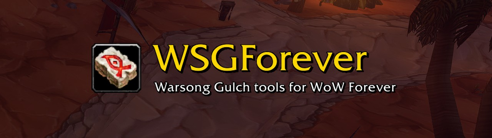
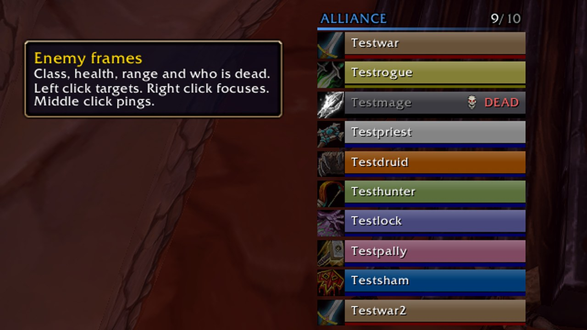
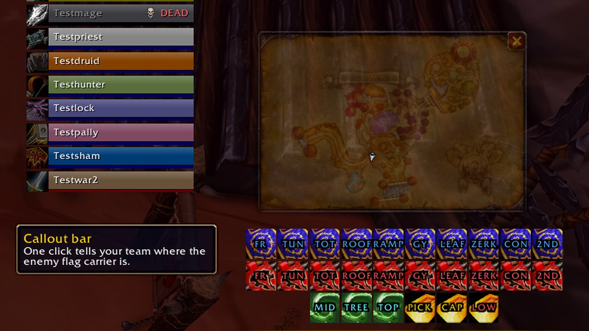
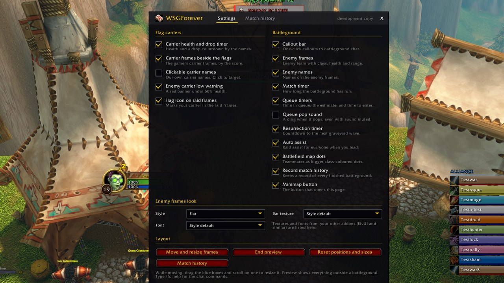

WSGForever is a Warsong Gulch addon for **World of Warcraft: Forever**. It helps your team track both flag carriers, call out where the enemy carrier is, watch the enemy team, and time the graveyard waves.

Get it on [CurseForge](https://www.curseforge.com/wow/addons/wsgforever) or from the [releases page](https://github.com/lichuu/WSGForever/releases).

## Features

### Flag and rez timers

Carrier health sits beside the score. A countdown shows when a dropped flag returns and when the flags spawn again after a capture, and a red banner warns when the enemy carrier is under half health. The rez timer counts down to the next graveyard wave in every battleground.

### Enemy frames

The whole enemy team with class, health, mana, range, who is dead and how many teammates are targeting each player. The flag carrier is highlighted. Left click targets, right click sets focus, middle click pings. Pick one of eleven looks on the settings tab, including ones that follow your ElvUI or EllesmereUI settings, and optionally a bar texture and font, including those your other addons share.

### Callout bar

One click tells your team where the enemy flag carrier is: both bases, midfield, and buttons for pick up, cap and "EFC low".

### Battlefield map

Teammates show as larger dots in their class colours. `/fc scale map` and `/fc scale mapdots` resize the map and the dots.

### Settings

A minimap button opens a settings page for every feature, also listed under Options > AddOns. Every option is a `/fc` command too.

### Match history
Every battleground you finish is recorded: win or loss, the flag score, how long it took, and your kills, deaths, honor, captures and returns. It lives on the Match history tab of the settings window (`/fc history`), with your overall record at the top. If you use Nova Instance Tracker, you can import the battlegrounds it already recorded.

### Key bindings
Every callout can be bound to a key in the game's Key Bindings menu, under WSGForever. So can targeting or pinging the enemy flag carrier and pinging your own.

### Also
- A flag icon on your team's carrier in the raid frames.
- The game's carrier frames moved up beside the score.
- Raid assist for everyone when you lead a battleground.

## Install
Copy the `WSGForever` folder into `World of Warcraft/_forever_/Interface/AddOns/`.

## Commands
Everything is in the settings window; these are the chat commands that remain.

- `/fc`: open the settings window (also on the minimap button and under Options > AddOns).
- `/fc history`: open the match history.
- `/fc who`: who else in your group has WSGForever, and their version.
- `/fc unlock` / `/fc lock`: move frames by dragging; scroll over a frame to resize it.
- `/fc test`: preview everything outside a battleground.
- `/fc reset`: reset positions and sizes.
- `/fc scale`: list sizes; `/fc scale <name> <percent>` sets one (also covers the map, map dots, carrier text and raid flag icon, which have no box to scroll on).
- `/fc minimap`: show or hide the minimap button.
- `/fc help`: list these in chat.

## Tests
`lua5.1 tests/run.lua .` loads the addon into a small stand-in for the game and replays flag scenarios (drops, hand-offs, captures, returns) plus every command. It checks what the addon decides to show, not how it looks.

## Releasing
Work happens on a branch. Pushing it runs the tests; `main` only accepts commits the tests have passed on, so it is always releasable. A release is an annotated tag on `main`:

1. Merge the branch into `main` (fast-forward) and push.
2. Move the notes under "Unreleased" in `CHANGELOG.md` to a new version heading, run `lua5.1 tests/release_notes.lua` (it writes that version's notes to `RELEASE_NOTES.md`, which is what the release page shows; the tests fail if it is stale), and push both to `main` the same way.
3. `git tag -a v1.2.3 -m v1.2.3 && git push origin v1.2.3`

The tag builds the zip, creates the GitHub release and triggers the CurseForge package. A tag that is not on `main` is refused.

## Credits
WSGForever stands on the shoulders of these, thank you:
- **vrjones1**: the [wsg rez timer and fc/efc hp](https://wago.io/cNXgQKDMd) WeakAura, which the rez timer and carrier HP are based on.
- **Bullsei**: [BattleGroundEnemies](https://github.com/BullseiWoWAddons/BattleGroundEnemies), the original enemy frames that inspired ours.
- **RBGDEV**: [BattleGroundEnemiesFixed](https://www.curseforge.com/projects/1444858), whose approach to targeting carriers and range checks on the modern client showed us the way.
- The **WeakAuras** team, for the addon the original auras were built in.

## License
[MIT](LICENSE)
