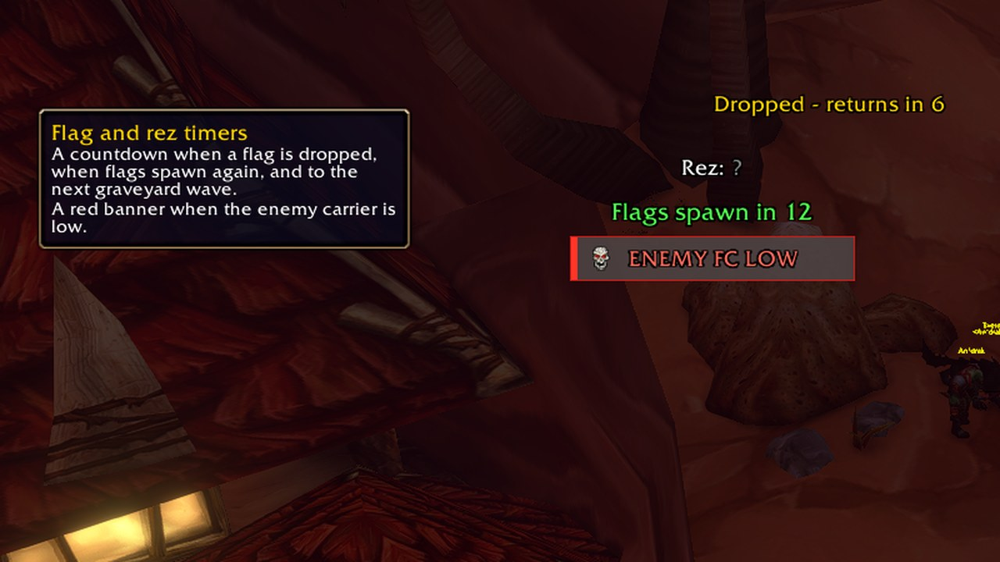
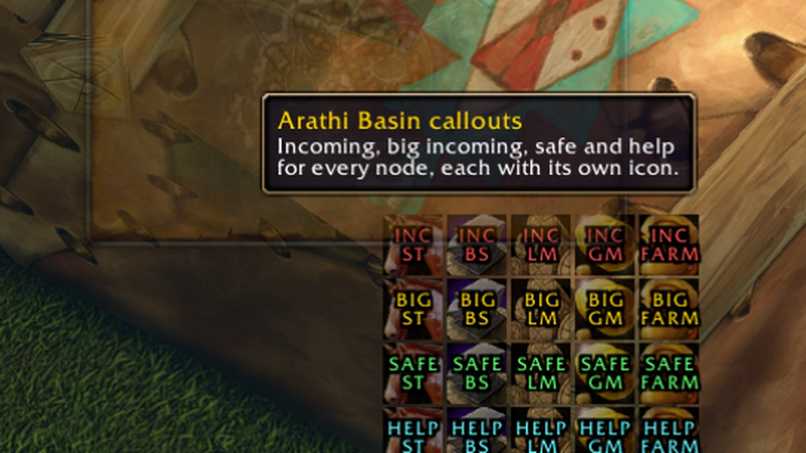
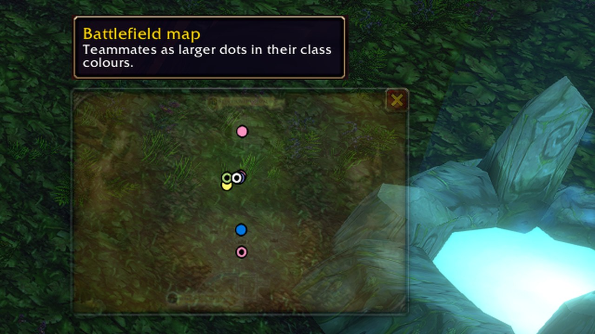
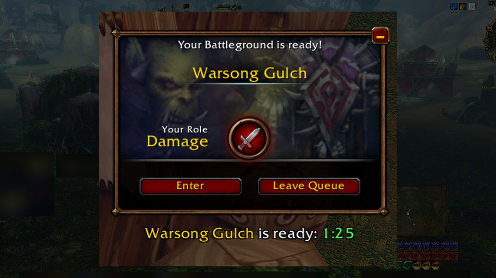

The Warsong Gulch addon for **World of Warcraft: Forever**. See who carries each flag and how hurt they are, know when the next graveyard wave lands, watch the whole enemy team, and tell your team where the enemy carrier is in one click.

Get it on [CurseForge](https://www.curseforge.com/wow/addons/wsgforever) or from the [releases page](https://github.com/lichuu/WSGForever/releases).

## Why WSGForever
- **One addon instead of a pile of WeakAuras.** Callouts, carrier tracking, timers, enemy frames and match history in one place, and they work together.
- **Built for Forever.** Forever hides some information from addons. Everything here is built around what the game actually allows, and tested in real matches.
- **Stays out of your way.** Every part can be turned off, moved and resized, with eleven looks for the enemy frames, including ones that follow ElvUI and EllesmereUI.
- **Free and open source** (MIT).

## Features

### Flag carriers and timers

Both flag carriers' health beside the score, a countdown when a flag is dropped, and one when the flags spawn again after a capture. A red banner warns when the enemy carrier is under half health. The rez timer counts down to the next graveyard wave with how many enemies are waiting to come back.

### Time Elapsed on the scoreboard

The scoreboard gets its Time Elapsed back, as one more tab at the bottom right that matches the game's own. It counts from the moment the gates open, shows the seconds in a tooltip when you hover over it, and stops when the match ends.

### Enemy frames

The whole enemy team with class, health, mana, range, who is dead and how many of your team are on each player; the flag carrier is highlighted. Left click targets, right click sets focus, middle click pings.

### Callout bar

One click tells your team where the enemy carrier is, from flag room to midfield, with buttons for pick up, cap and enemy carrier low.

### Arathi Basin callouts

In Arathi Basin the bar switches to Incoming, Big incoming, Safe and Help for each of the five nodes, each with its own icon.

### Match history
Every battleground you finish is recorded: result, flag score, length, and your kills, deaths, honor, captures and returns. Hover a match to see its final scoreboard, both teams in class colours. Already using Nova Instance Tracker? Import the battlegrounds it recorded.

### Battlefield map

Teammates show as larger dots in their class colours.

### Queue pop countdown

When your queue pops, a countdown under the ready window shows how long is left to enter. An optional ding plays even with sound effects muted.

### Settings
A minimap button opens a settings window with every option, and a second tab for match history. It is also under Options > AddOns.

### Key bindings
Every callout can be bound to a key in the game's Key Bindings menu, under WSGForever, and so can targeting or pinging the enemy flag carrier and pinging your own.

### Also
- A flag icon on your team's carrier in the raid frames.
- The game's carrier frames moved up beside the score.
- Raid assist for everyone when you lead a battleground.
- `/fc who` shows who else in your group runs WSGForever.

## Install
Copy the `WSGForever` folder into `World of Warcraft/_forever_/Interface/AddOns/`.

## Commands
Everything is in the settings window; these are the chat commands that remain.

- `/fc`: open the settings window (also on the minimap button and under Options > AddOns).
- `/fc history`: open the match history.
- `/fc who`: who else in your group has WSGForever, and their version.
- `/fc unlock` / `/fc lock`: move frames by dragging; scroll over a frame to resize it.
- `/fc test`: preview everything outside a battleground.
- `/fc reset`: reset positions and sizes.
- `/fc scale`: list sizes; `/fc scale <name> <percent>` sets one (also covers the map, map dots, carrier text and raid flag icon, which have no box to scroll on).
- `/fc minimap`: show or hide the minimap button.
- `/fc help`: list these in chat.

## Tests
`lua5.1 tests/run.lua .` loads the addon into a small stand-in for the game and replays flag scenarios (drops, hand-offs, captures, returns) plus every command. It checks what the addon decides to show, not how it looks.

## Releasing
Work happens on a branch. Pushing it runs the tests; `main` only accepts commits the tests have passed on, so it is always releasable. A release is an annotated tag on `main`:

1. Merge the branch into `main` (fast-forward) and push.
2. Move the notes under "Unreleased" in `CHANGELOG.md` to a new version heading, run `lua5.1 tests/release_notes.lua` (it writes that version's notes to `RELEASE_NOTES.md`, which is what the release page shows; the tests fail if it is stale), and push both to `main` the same way.
3. `git tag -a v1.2.3 -m v1.2.3 && git push origin v1.2.3`

The tag builds the zip, creates the GitHub release and triggers the CurseForge package. A tag that is not on `main` is refused.

## Credits
WSGForever stands on the shoulders of these, thank you:
- **vrjones1**: the [wsg rez timer and fc/efc hp](https://wago.io/cNXgQKDMd) WeakAura, which the rez timer and carrier HP are based on.
- **Bullsei**: [BattleGroundEnemies](https://github.com/BullseiWoWAddons/BattleGroundEnemies), the original enemy frames that inspired ours.
- **RBGDEV**: [BattleGroundEnemiesFixed](https://www.curseforge.com/projects/1444858), whose approach to targeting carriers and range checks on the modern client showed us the way.
- The **WeakAuras** team, for the addon the original auras were built in.

## License
[MIT](LICENSE)
