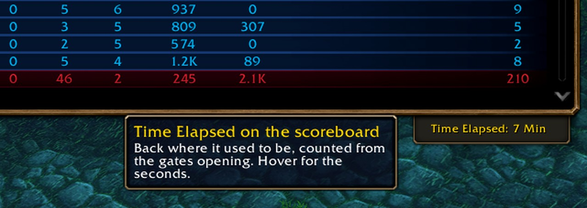

- Time Elapsed is back on the scoreboard: the match time, counted from the gates opening, shows as one more tab at the bottom-right of the game's scoreboard, and on the results window at the end of a match. It reads in minutes, and to the second while your mouse is over it, without the tab changing size. It stops when the match ends, so it reads how long the match took.
- The small match clock beside the score is gone, now that the time is on the scoreboard. The setting is called Scoreboard time; `/fc timer` still turns it on and off.

